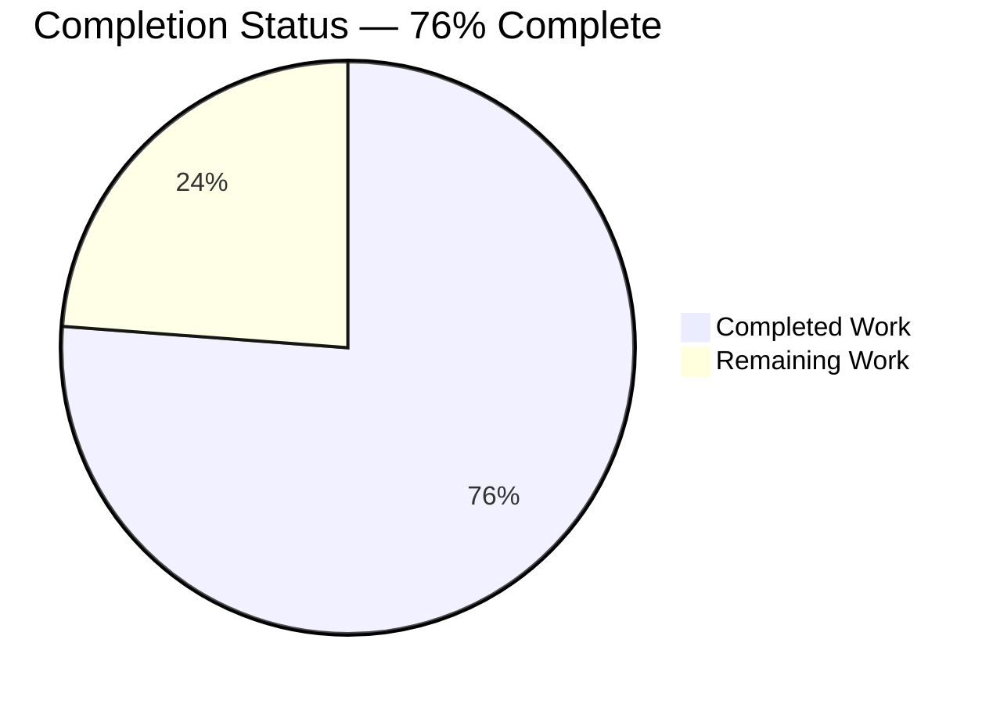
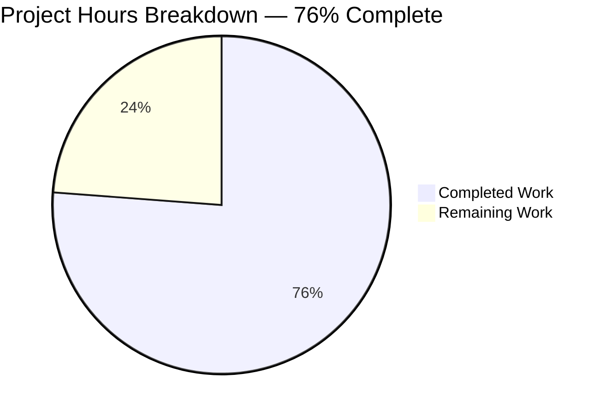
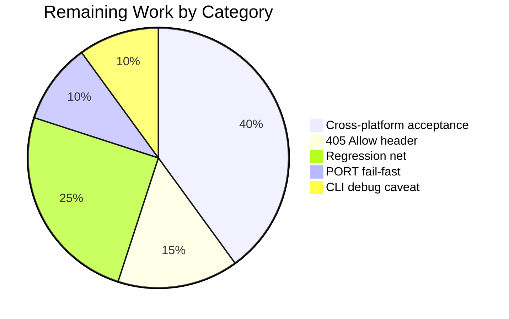

# 1. Executive Summary

Sign-off summary for the Hello World Web App.

## 1.1 Project Overview

A small Flask service a developer runs locally. It greets a visitor on an HTML page, personalises that greeting from a name typed into the page's form, and returns the same greeting as JSON on a second route. Its users are the developer who starts it, a visitor who types a name, and a scripted client calling the JSON route. It is deliberately minimal: one module, one template, one suite, two pinned dependencies, no database and no build step.

## 1.2 Completion Status

Completion is scoped to the plan: 32 of 42 hours are complete — **76% complete**.



Brand colours: Completed = Dark Blue `#5B39F3`; Remaining = White `#FFFFFF`.

| Metric | Hours |
|---|---|
| Total Hours | 42 |
| Completed Hours (AI + Manual) | 32 |
| Remaining Hours | 10 |

All six planned files are present and verified. 27 of 29 requirement items are fully met; the cross-platform claim is proven on one of three operating systems.

## 1.3 Key Accomplishments

- **Greeting page** — `GET /` shows `Hello, World!` and personalises from the labelled form.
- **JSON route** — `GET /api/hello` returns the greeting as `application/json`.
- **Length limit** — enforced server-side on both surfaces; the rejected value is never echoed.
- **Escaping** — script characters render as text, with no `<script>` in the response.
- **Error contracts** — 404 and 405 as fixed plain-text bodies.
- **Startup** — one install and one run command, `PORT`/`FLASK_RUN_PORT`, loopback-only, debugger closed.
- **Test suite** — 18 cases pass with no server and no bound port.
- **Documentation** — a README from install to a green suite.

## 1.4 Critical Unresolved Issues

**5 of 24** requirement items remain open in some respect; none is undelivered, and no planned file is missing.

| Issue | Impact | Owner | ETA |
|---|---|---|---|
| Cross-platform acceptance on Linux and Windows never exercised (NFR1) | The three-OS, Python 3.11+ claim is proven on macOS only | Development | 4 h |
| 405 responses omit the HTTP-mandated `Allow` header (FR8) | A strict client or conformance suite may flag the response | Development | 1.5 h |
| Page form observables and the PUT/DELETE 405 variants are not pinned by the suite (FR2, FR5, FR8) | A future edit could regress the labelled field, the retained or emptied value, or those methods silently | Development | 2.5 h |
| A malformed `PORT` aborts both start paths and test collection with a `ValueError` traceback (NFR5) | An operator sets a bad value and sees a stack trace instead of a message | Development | 1 h |
| The Flask CLI start path opens the Werkzeug debugger console when `FLASK_DEBUG` is exported (debug-surface control) | Interactive code execution if that start path runs with an uncontrolled environment | Operations | 1 h |

## 1.5 Access Issues

No access issues identified. No credentials, keys or service accounts are needed; the service binds loopback and calls nothing over the network.

## 1.6 Recommended Next Steps

1. **[High]** Run the acceptance sweep on Linux and Windows — both start paths, both port overrides, `pytest` (4 h).
2. **[Medium]** Add the 405 `Allow` header and assert it (1.5 h).
3. **[Medium]** Pin the page's form observables and the PUT/DELETE 405 responses in the suite (2.5 h).
4. **[Medium]** Make a malformed `PORT` fail legibly and keep `FLASK_DEBUG` unset wherever the app starts (2 h).
5. **[Low]** Decide whether the service ever leaves loopback; production hosting would be a new instruction.

# 2. Project Hours Breakdown

Hours are scoped to the plan's deliverables. Every component below traces to a requirement in that plan and to the files that satisfy it.

Section 2.1 (32 h) + Section 2.2 (10 h) = **42 total hours**, and 32 / 42 = **76% complete**.

## 2.1 Completed Work Detail

| Component | Hours | Description |
|---|---|---|
| Environment and dependency manifest | 2 | `requirements.txt` pinned to Flask 3.1.3 and pytest 9.1.1; a clean install resolves exactly those versions with their transitive closure and no resolver conflict. |
| Application module | 9 | `app.py`: the greeting constants, the three pure helpers (`normalise_name`, `is_too_long`, `greeting_for`), both GET views, the plain-text 404 and 405 handlers, the `PORT` entry point and the docstrings on every public interface. |
| Greeting page template | 3 | `templates/index.html`: the greeting heading, the conditional error paragraph and the labelled name form, with autoescaping left on and the five rendered states the plan fixes. |
| Test package | 7 | The zero-byte `tests/__init__.py` marker that makes the documented `pytest` command resolve the module, the `TESTING` client fixture, and 14 functions / 18 cases over both routes, the length boundary from both sides, blank and whitespace-only inputs, and escaping. |
| README documentation | 5 | Install, both start paths with their own port variable, the per-shell override forms, the test command, the route table with runnable examples, and the rejection and escaping states. |
| Runtime verification | 6 | Every enumerated state exercised against the running service on both start paths, loopback and debug-surface checks, the escaping assertion verified on the raw response, and request latency measured. |
| **Total** | **32** | |

## 2.2 Remaining Work Detail

| Category | Hours | Priority |
|---|---|---|
| Cross-platform acceptance on Linux and Windows for the Python 3.11+ / three-OS claim (NFR1) | 4.0 | High |
| HTTP conformance of the 405 response — the `Allow` header plus its test (FR8) | 1.5 | Medium |
| Regression net for the page's form observables and the PUT/DELETE 405 variants (FR2, FR5, FR8) | 2.5 | Medium |
| Fail-fast configuration: a readable failure for a malformed `PORT` (NFR5) | 1.0 | Medium |
| Start-path caveat: the Flask CLI path's ambient `FLASK_DEBUG` exposure (debug-surface control) | 1.0 | Medium |
| **Total** | **10.0** | |

# 3. Test Results

The suite was run from the repository root with the pinned stack (pytest 9.1.1 on Python 3.13.16) and needs no server and no bound port: **18 of 18 cases pass, 0 fail, in about 0.05 seconds**. Fourteen test functions produce those 18 cases; two of them are parametrised over three inputs each. No coverage measurement tool is installed — the plan caps dependencies at the two pins — so coverage is shown by the behaviour each row proves rather than by a percentage.

| Area / Category | Framework | Tests | Passed | Failed | Coverage | What This Proves |
|---|---|---|---|---|---|---|
| Greeting page — default and blank/whitespace inputs | pytest | 4 | 4 | 0 | Not measured (no coverage tool in scope) | A request with no usable name always renders `Hello, World!` and no error paragraph, whatever the empty, space-only or over-long-space input. |
| Greeting page — personalisation and the 50-character boundary | pytest | 2 | 2 | 0 | Not measured | A submitted name reaches the heading, and a name of exactly 50 characters is greeted in full. |
| Greeting page — rejection and escaping | pytest | 2 | 2 | 0 | Not measured | An over-long name shows the fixed error while the heading stays `Hello, World!` and the value is absent from the body; script characters render escaped with no `<script>` in the response. |
| JSON route — default and blank/whitespace inputs | pytest | 4 | 4 | 0 | Not measured | `/api/hello` answers `{"message": "Hello, World!"}` for no name, an empty name and a space-only name at any length. |
| JSON route — personalisation and the 50-character boundary | pytest | 2 | 2 | 0 | Not measured | The route greets a supplied name, and 50 characters are accepted in full. |
| JSON route — rejection and HTML characters as data | pytest | 2 | 2 | 0 | Not measured | An over-long name returns 400 with the fixed error and no `message` key; script characters travel verbatim inside the JSON body with an `application/json` content type. |
| Error routes — 404 and 405 contracts | pytest | 2 | 2 | 0 | Not measured | An unmatched path answers 404 and an unsupported method answers 405, both with the fixed plain-text bodies. |
| Live end-to-end sweep against the running service | curl and the Flask test client | 19 | 19 | 0 | Not measured | Every state the plan enumerates answers exactly as specified on a real server on `127.0.0.1`, including both port overrides, the loopback binding and the error contracts. |

**Not Covered**
- The page's form-level observables — the label text, the submit button, `maxlength="50"`, the value retained on acceptance and the field emptied on rejection. They are correct on inspection and were confirmed by driving the real page, but no test asserts them, so a future edit could change them without failing the suite.
- The `PUT /api/hello` and `DELETE /` 405 responses: the suite pins `POST /` only. All three were exercised by hand.
- The `Allow` header on 405 responses — it is absent, and no test covers it.
- The `PORT` override and both documented start commands: verified by command against a running server, never by an automated test, because the suite runs in process and binds no socket.
- Linux and Windows runtime behaviour, and the README's cmd.exe and PowerShell override lines: never executed on any machine.
- Docstring and comment text: no assertion exists on it.

Before release, a human should extend the suite to pin the first three items and run the platform sweep; both are costed in Section 2.2.

# 4. Runtime Validation & UI Verification

Every flow below was driven against a running instance of the service, started with the documented commands, with the observed result stated. Request latency was measured over 300 requests per surface.

- ✅ **Start-up** — `python app.py` (with `PORT`) and `python -m flask --app app run` (with `FLASK_RUN_PORT`) both serve, both announce "Debug mode: off", and both bind `127.0.0.1` only.
- ✅ **Greeting page** — `GET /` returns 200 `text/html; charset=utf-8` with one `<h1>Hello, World!</h1>`, the labelled form and no error element.
- ✅ **Personalisation through the form** — submitting `Ada` issues `/?name=Ada` and returns `<h1>Hello, Ada!</h1>` with the field retaining `Ada`.
- ✅ **JSON greeting route** — `/api/hello` returns `{"message": "Hello, World!"}` and `/api/hello?name=Ada` returns `{"message": "Hello, Ada!"}`, both 200 `application/json`.
- ✅ **Length limit on both surfaces** — 50 characters accepted in full; 51 characters give the API 400 with `{"error": "Name must be 50 characters or fewer."}`, and the page 200 showing the error paragraph, the `Hello, World!` heading and an emptied field, with the rejected run absent from the body.
- ✅ **Escaping** — a script payload appears as escaped text twice (heading and field) with zero `<script>` occurrences; the JSON route carries the same characters unescaped as data.
- ✅ **Error contracts** — `/nope` answers 404 and `POST /`, `PUT /api/hello` and `DELETE /` answer 405, all as fixed plain text; `HEAD /` answers 200.
- ✅ **Port configuration** — served on the default 5000 and on overridden ports on both start paths, each time loopback-only.
- ✅ **Performance** — page requests median 0.068 ms (p95 0.073 ms), API requests median 0.061 ms (p95 0.064 ms), against a one-second target.
- ⚠ **Debug surface** — closed on the module entry point even when `FLASK_DEBUG=1` is exported (`/console` returns this app's own plain-text 404); on the Flask CLI start path an exported `FLASK_DEBUG` does start the Werkzeug interactive console, which neither documented command sets.

**Never exercised:** the Linux and Windows runtime — the suite and both start commands have been run on macOS only — and the README's cmd.exe and PowerShell override lines, which have never been executed on any machine.

# 5. Compliance & Quality Review

Each delivered capability is measured below against the quality and compliance benchmarks that apply to it: functional correctness against the fixed contract, server-side validation, output encoding, HTTP semantics, documentation reproducibility, cross-platform parity, dependency discipline and the plan's own code, comment and security standards. Where a benchmark is only partly met, the gap is stated in the row and the work it needs is costed in Section 2.2.

## 5.1 Compliance Matrix

| Deliverable (plan requirement) | Quality / compliance benchmark | Verified status |
|---|---|---|
| Greeting page at `GET /` (FR1) | Functional correctness against the fixed contract | ✅ Pass |
| Form personalisation (FR2) | Functional correctness; labelled, operable control | ✅ Pass |
| JSON greeting route (FR3, FR4) | API contract, payload shape and content type | ✅ Pass |
| Length limit on both surfaces (FR5) | Server-side validation independent of the client attribute | ✅ Pass |
| HTML and script escaping (FR6) | Output-encoding control on reflected input | ✅ Pass |
| Unknown-route response (FR7) | Fixed, non-reflective error body with correct status and content type | ✅ Pass |
| Unsupported-method response (FR8) | Same, plus HTTP method semantics | ⚠ Partial — bodies, statuses and content types correct; the `Allow` header is absent |
| Documentation (FR9) | Documented install, run and test reproducible by a reader | ✅ Pass on POSIX; the per-shell override lines have not been executed on Windows |
| Cross-platform parity (NFR1) | Runs on Linux, macOS and Windows with no platform-specific step | ⚠ Partial — no platform-specific step exists, but one of the three operating systems has been exercised |
| Performance, data handling and dependency posture (NFR2, NFR3, NFR4) | Sub-second responses; nothing stored or logged by the app; dependencies capped at two pins | ✅ Pass |
| Configuration and startup (NFR5, NFR6) | One install command, one run command, port override on both start paths | ✅ Pass |
| Code, comment and security standards (0.14.1, 0.14.2, 0.3.2) | One-line docstrings on public interfaces; comments only where they earn it; escaping on, server-side limit, loopback binding, debugger closed | ✅ Pass, with the Flask CLI start-path caveat recorded below |

## 5.2 AAP & Rule Divergences and Gaps

Five departures from the plan as literally written were identified. Each is a fact about this codebase, recorded with what was asked for, what is delivered, why, the impact and what a human should do. The first is sanctioned by a higher-ranked requirement in the same plan.

| What the Plan Required | What Was Delivered Instead | Why It Diverged | Impact | Remediation |
|---|---|---|---|---|
| The entry point as `app.run(port=PORT)` (0.6.1) | `app.run(port=PORT, debug=False)` — `app.py:87` | The plan's own debug-surface requirement and its security standard require the Werkzeug debugger console closed; the literal form leaves that to the ambient environment | Strictly stronger; identical behaviour when `FLASK_DEBUG` is unset | None. Optionally align the plan's sketch with the delivered line |
| `METHOD_NOT_ALLOWED_MESSAGE` as a single line (0.6.1) | The same constant wrapped in parentheses across `app.py:13-15` | The plan's own "no line over the conventional width" rule conflicts with a 99-character literal | None — the string value is byte-identical | None |
| Every module carries a one-line module docstring (0.14.2) | `tests/__init__.py` is exactly zero bytes — no docstring | The file-specific directives (0.6.1, 0.8.1, 0.8.2) fix its content as empty and make its presence, not its content, the contract | A docstring census across the six modules reads 5 of 6; no runtime effect | None while the emptiness contract stands. If a house standard is adopted, amend the plan's file contract first |
| The request's commands reproduced exactly (0.11.4); no platform-specific shell script (0.9.2) | The README additionally documents the cmd.exe and PowerShell forms of both port overrides — `README.md:41-55`, `63-75` | The three-operating-system requirement cannot be met for a Windows reader by POSIX-only instructions | Documentation is longer than the plan's minimum; the specified POSIX commands survive byte-for-byte and no script was added | None |
| The debugger console stays closed (0.3.2) | Closed in `app.py` and absent from both documented commands, but an exported `FLASK_DEBUG=1` still starts the Werkzeug console on the Flask CLI start path | The Flask CLI resolves its debug flag before importing `app.py`, so the application cannot govern that path | Interactive code execution on a loopback port if the process environment is uncontrolled | Keep `FLASK_DEBUG` unset, control the environment in any wrapper that starts the app, and document the caveat — the 1 h item in Section 2.2 |

**Entry-point debug argument.** The plan fixes the application's last line as `app.run(port=PORT)`. What ships is `app.run(port=PORT, debug=False)` at `app.py:87`. The plan's own requirements say the debugger console stays closed and debug mode is not enabled in code; the literal form holds only while `FLASK_DEBUG` is unset, because Flask resolves the flag from the environment when the call states none. The delivered line closes the console unconditionally on this start path, confirmed live: with `FLASK_DEBUG=1` exported the banner reads "Debug mode: off" and `/console` returns this app's own plain-text 404. No host argument or other flag was added, and `PORT` is untouched. No human work is needed; if the sketch is treated as a contract, update it to match the code.

**Wrapped error constant.** The plan presents `METHOD_NOT_ALLOWED_MESSAGE` as a single 99-character line. The delivered constant is wrapped in parentheses across `app.py:13-15`, which the plan's own style rule forces: no line may exceed the conventional width. The string value is byte-identical to the plan's, and the suite asserts the rendered message rather than the source form, so nothing observable changed. Two consequences matter to a maintainer: a wording change must be made in both `app.py` and `tests/test_app.py`, because the suite hard-codes the expected text rather than importing the constant; and the wrapped form is the only place the source's shape differs from the plan's presentation. No human action is required.

**Empty test-package marker.** The plan's quality standard says every module carries a one-line docstring, and `tests/__init__.py` carries none — it is exactly zero bytes. That is deliberate and required by the plan's more specific directives, which fix the file's content as empty and make its presence, not its content, the contract: the marker puts the repository root on the import path so the documented `pytest` command resolves `from app import app`. Removing it reproduces a collection failure, observed directly. The cost is cosmetic: a docstring census over the six modules reads five of six. A human needs to do nothing unless a house documentation standard is introduced, in which case amend the file contract first so the two do not contradict each other.

**Per-shell port override.** The plan reproduces the request's commands exactly and rules out platform-specific shell scripts, so its port-override text shows only the POSIX `VAR=value command` form. The README keeps those commands unchanged and additionally gives the cmd.exe (`set PORT=5057`) and PowerShell (`$env:PORT="5057"`) forms for both start paths, at `README.md:41-55` and `63-75`. The reason is the plan's cross-platform requirement: the README advertises three operating systems, and a Windows reader following a POSIX-only instruction would hit a shell error instead of the override. No script or extra file was added, and the override was exercised live on both start paths. A human should decide only whether the extra per-shell text is wanted in a "short README".

**Environment-governed debug flag on the Flask CLI path.** The plan's debug-surface requirement is met in the application: `app.py` never enables debug mode, and neither documented command passes `--debug`. The remaining exposure is outside `app.py`'s reach, because Flask's CLI resolves its debug flag before importing the module. An operator who exports `FLASK_DEBUG=1` and starts the app with `python -m flask --app app run` therefore gets the Werkzeug interactive console — reproduced live: the banner reads "Debug mode: on" with a debugger PIN, and `/console` serves the console page. The documented command does not set the variable, so this is a limitation rather than an unmet requirement; the `python app.py` path stays closed even then. Keep `FLASK_DEBUG` unset wherever the app starts — the 1 h item in Section 2.2.

# 6. Risk Assessment

Each risk is forward-looking: what could still go wrong once this code is in use. Severity and probability are judged for the product as scoped — a local, single-user, loopback-bound service.

| Risk | Category | Severity | Probability | Mitigation | Status |
|---|---|---|---|---|---|
| The Linux and Windows arms of the three-operating-system claim are unverified | Technical | Medium | Medium | Run the suite and both start commands on the two remaining operating systems; nothing in the code is platform-specific and both dependencies are pure Python | Open |
| An exported `FLASK_DEBUG` starts the Werkzeug interactive console on the Flask CLI start path | Security | High | Low | Keep the variable unset, control the process environment in any wrapper, and document the caveat; the `python app.py` path is already closed | Open |
| Exposing the service beyond the loopback interface would put an unhardened development server on the network | Operational | High | Low | Keep the loopback binding; any network exposure needs a production WSGI server, TLS and response hardening as a new instruction | Accepted by design |
| The 405 response omits the HTTP-mandated `Allow` header | Technical | Low | Medium | Add the header in the handler's third tuple element without changing the body, status or content type | Open |
| No response-hardening headers (`nosniff`, frame-ancestors, HSTS) and no request-size or rate limit exist | Security | Low | Low | Acceptable while bound to loopback; add an `after_request` hook or front the app with a proxy if exposure changes | Accepted by design |
| The transitive dependency closure is unpinned, so a later install can resolve newer versions — including the one binary wheel in the closure | Integration | Low | Medium | Pin or constrain the closure if a byte-reproducible install is required; today's resolution is Flask 3.1.3, pytest 9.1.1, Werkzeug 3.1.9, Jinja2 3.1.6, MarkupSafe 3.0.4, click 8.5.0, itsdangerous 2.2.0, blinker 1.9.0, pluggy 1.7.0, iniconfig 2.3.1, packaging 26.3, Pygments 2.21.0 | Accepted by design |
| Two page-level observables and two unsupported methods are not pinned by the suite, so they could change without a test failing | Technical | Low | Medium | Extend the suite to assert the labelled field, the retained and emptied input values, and the PUT/DELETE 405 responses | Open |
| Start-up and configuration surprises — a malformed `PORT` aborts start-up with a traceback, and a slow reverse-DNS resolver delays the socket listen | Operational | Medium | Low | Validate the port before use and name the acceptable range in the failure message; poll the address for readiness instead of assuming the process has hung | Open |

No integration risk arises from an external service: the application calls nothing over the network, holds no credentials and writes no data, so authentication, third-party availability and data-synchronisation risks do not apply.

# 7. Visual Project Status

Completion, remaining effort and priority all refer to the same figures used in Sections 1.2 and 2.2.



Brand colours: Completed = Dark Blue `#5B39F3`; Remaining = White `#FFFFFF`.

Remaining hours by category (from Section 2.2), same 10-hour total:



| Priority | Items | Hours |
|---|---|---|
| High | Cross-platform acceptance on Linux and Windows | 4.0 |
| Medium | 405 `Allow` header, regression net, `PORT` fail-fast, CLI debug caveat | 6.0 |
| Low | None outstanding | 0.0 |
| **Total remaining** | | **10.0** |

# 8. Summary & Recommendations

The Hello World Web App is functionally complete and independently verifiable. One application module defines two GET routes over one scalar input, one Jinja template renders the page and carries the name form, and one test module drives both routes through Flask's test client. Every state the plan enumerates was exercised against the running service: the default and personalised greetings, blank and whitespace-only names on both surfaces, the 50-character boundary from both sides, an over-long name rejected with the API's 400 and the page's error paragraph while the heading falls back to `Hello, World!`, script characters escaped on the page and carried as data in JSON, and fixed plain-text 404 and 405 responses. The suite reports 18 of 18 cases passing from the repository root with no server and no bound port.

That verified state is 32 of the 42 hours the work spans — **76% complete**. The remaining 10 hours are acceptance and hardening rather than missing functionality: the three-operating-system claim is proven on macOS only, the 405 response omits the HTTP-mandated `Allow` header, four page-level observables and two unsupported methods are not pinned by the suite, a malformed `PORT` fails with a traceback instead of a message, and an exported `FLASK_DEBUG` opens the Werkzeug console on the Flask CLI start path. None of these stops the service from doing what it was asked to do; together they are what stands between a verified prototype and a signed-off release.

The critical path is short and sequential. First, run the acceptance sweep on Linux and Windows — the only way to close the platform claim, and the largest single item at 4 hours. Then close the conformance and regression gaps in the code and its suite (4 hours together: the `Allow` header and the observables no test pins), which removes the risk of a silent regression in the page's form behaviour. Then make the configuration fail legibly and record the CLI debug caveat (2 hours), which turns two operational surprises into documented behaviour. After that, remaining work is zero and the completion figure reaches its verified maximum.

Success for this release is measurable on the code as it stands: 18 of 18 automated cases pass; both documented start commands serve on loopback with debug off; both port overrides work; the escaping assertion holds with zero raw `<script>` in the response; requests complete in about 0.07 ms at the median against a one-second target; and the dependency manifest still declares exactly two pinned packages with no build step and no data store.

Overall production readiness is **ready for its stated purpose — a local, loopback-bound, development-run prototype — and not ready for network exposure.** The development server, the absence of TLS and hardening headers, and the lack of authentication or rate limiting are deliberate scope decisions for a single local user, not gaps in the implementation. Anything beyond that boundary — hosting, a reverse proxy, multiple users — should arrive as a new instruction, and the plan's exclusion boundary means nothing in this tree is a stub or a hook waiting for it.

| Metric | Value |
|---|---|
| AAP-scoped completion | 76% (32 h of 42 h) |
| Requirement items met | 27 of 29 fully met; 1 partially (cross-platform acceptance); 1 met under the plan's own more specific directive |
| Deliverables | 6 of 6 planned files present; 370 lines of delivered content |
| Automated tests | 18 of 18 passing, 0 failing, 14 functions |
| Live state sweep | 19 of 19 checks as specified |
| Median request latency | 0.07 ms page, 0.06 ms API |
| Remaining effort | 10 h (1 High, 4 Medium) |
| Open divergences and gaps | 5 divergences recorded; 1 needs work |

# 9. Development Guide

### System Prerequisites

- **Python 3.11 or later.** The project's floor. Verified on Python 3.13.16.
- **No compiler, OS package or system service.** Both dependencies are pure Python, so nothing has to be built and no database, broker or cache has to run.
- **Runs on Linux, macOS and Windows** with no platform-specific step. Only the shell syntax for setting an environment variable differs, and the README gives all three forms.

### Environment Setup

Create a virtual environment in the repository root and install the two pinned dependencies. Every command below was executed from the repository root.

```bash
python3.13 -m venv .venv                    # any Python 3.11+ interpreter works
.venv/bin/python -m pip install -r requirements.txt
```

The install resolves exactly the pinned versions and exits 0. Confirm them:

```bash
.venv/bin/python -m pip list --format=freeze | grep -E '^(Flask|pytest)=='
```

Expected:

```text
Flask==3.1.3
pytest==9.1.1
```

Compile and import checks:

```bash
.venv/bin/python -m py_compile app.py
.venv/bin/python -c "import app; print(app.app)"
```

Expected: no output from the first command, and `<Flask 'app'>` from the second.

### Application Startup

Two documented start paths exist and each reads a different environment variable for its port.

```bash
# Module entry point — reads PORT, defaults to 5000
PORT=5000 .venv/bin/python app.py

# Flask CLI path — reads FLASK_RUN_PORT, because the CLI resolves its port before importing app.py
FLASK_RUN_PORT=5000 .venv/bin/python -m flask --app app run
```

Both must be started **from the repository root**; `--app app` resolves the module from the working directory. Each logs a banner naming the address:

```text
 * Serving Flask app 'app'
 * Debug mode: off
 * Running on http://127.0.0.1:5000
```

Start-up can take several seconds before the socket listens, because the development server performs a reverse-DNS lookup while binding. Poll the address rather than assuming the process has hung:

```bash
for i in $(seq 1 20); do curl -s -o /dev/null -m 2 http://127.0.0.1:5000/ && break; sleep 3; done
```

The server binds `127.0.0.1` only, so it is not reachable from the network. Stop it with Ctrl-C, or by the pid you started it with.

### Verification Steps

Run the suite — it drives Flask's test client, so no server and no port are needed:

```bash
.venv/bin/python -m pytest
```

Expected:

```text
18 passed in 0.05s
```

Then confirm the running service answers as documented:

```bash
curl -s http://127.0.0.1:5000/ | grep -o '<h1>[^<]*</h1>'                   # <h1>Hello, World!</h1>
curl -s "http://127.0.0.1:5000/?name=Ada" | grep -o '<h1>[^<]*</h1>'        # <h1>Hello, Ada!</h1>
curl -s http://127.0.0.1:5000/api/hello                                     # {"message":"Hello, World!"}
curl -s "http://127.0.0.1:5000/api/hello?name=Ada"                          # {"message":"Hello, Ada!"}
curl -s -w '\n%{http_code}\n' "http://127.0.0.1:5000/api/hello?name=$(printf 'a%.0s' {1..51})"
curl -si http://127.0.0.1:5000/nope | head -3                               # 404, text/plain; charset=utf-8
curl -si -X POST http://127.0.0.1:5000/ | head -3                           # 405, text/plain; charset=utf-8
```

### Example Usage

The page is the primary interaction: open `http://127.0.0.1:5000/`, type a name into the field labelled `Your name` and press `Greet me`. The URL becomes `/?name=<your name>` and the heading reads `Hello, <your name>!`. Leaving the field empty or typing only spaces keeps `Hello, World!`; a name longer than 50 characters shows `Name must be 50 characters or fewer.` while the heading stays `Hello, World!` and the field is emptied; HTML or script characters appear as visible text.

Programmatic use:

```bash
curl -s "http://127.0.0.1:5000/api/hello?name=World"
# {"message":"Hello, World!"}

curl -s "http://127.0.0.1:5000/api/hello?name=%3Cscript%3Ealert(1)%3C%2Fscript%3E"
# {"message":"Hello, <script>alert(1)</script>!"}   — characters travel as JSON data, not markup
```

### Troubleshooting

| Symptom | Cause | Resolution |
|---|---|---|
| `Error: Could not import 'app'.` | The CLI command was run from outside the repository root | Run it from the root, where `app.py` lives |
| `ValueError: invalid literal for int() with base 10: 'abc'` at `app.py:21` | `PORT` is converted to an integer when the module is imported | Set `PORT` to a number; the same failure also stops the CLI path and test collection while it is set |
| `no tests ran` | `pytest` was run from outside the repository root | Run it from the root; the suite is discovered in `tests/` |
| `ModuleNotFoundError: No module named 'app'` during collection | The zero-byte `tests/__init__.py` marker is missing | Restore the empty file — its presence, not its content, puts the repository root on the import path |
| The page loads but the port is not the one you set | The Flask CLI path does not read `PORT` | Use `PORT` with `python app.py`, or `FLASK_RUN_PORT` with the CLI command |
| The greeting shows escaped text such as `&lt;script&gt;` | Expected behaviour | Names containing HTML characters are shown as text, never executed |
| The console logs a 404 for `/favicon.ico` | The browser requests an icon the page does not ship, and it is answered by the app's own 404 contract | Expected; the app intentionally ships no assets |
| The debugger is reachable at `/console` | `FLASK_DEBUG` is exported in the environment of the Flask CLI start path | Unset `FLASK_DEBUG`; the `python app.py` path is closed regardless |

# 10. Appendices

### A. Command Reference

| Command (run from the repository root) | Purpose | Expected result |
|---|---|---|
| `python3.13 -m venv .venv` | Create the virtual environment | `.venv/` created, self-ignoring |
| `.venv/bin/python -m pip install -r requirements.txt` | Install the two pins and their closure | exit 0; Flask 3.1.3 and pytest 9.1.1 |
| `.venv/bin/python -m py_compile app.py` | Compile check | no output |
| `.venv/bin/python -c "import app; print(app.app)"` | Import check | `<Flask 'app'>` |
| `PORT=5000 .venv/bin/python app.py` | Start via the module entry point | banner, then `Running on http://127.0.0.1:5000` |
| `FLASK_RUN_PORT=5000 .venv/bin/python -m flask --app app run` | Start via the Flask CLI | same address; `--debug` is deliberately absent |
| `.venv/bin/python -m pytest` | Run the suite | `18 passed` |
| `curl -s http://127.0.0.1:5000/` | Fetch the greeting page | HTML with `<h1>Hello, World!</h1>` |
| `curl -s "http://127.0.0.1:5000/api/hello?name=Ada"` | Fetch a personalised greeting | `{"message":"Hello, Ada!"}` |
| `curl -si http://127.0.0.1:5000/nope` | Check the 404 contract | `404`, `text/plain; charset=utf-8` |
| `curl -si -X POST http://127.0.0.1:5000/` | Check the 405 contract | `405`, `text/plain; charset=utf-8` |

### B. Port Reference

| Item | Value |
|---|---|
| Default port | `5000` |
| Binding | `127.0.0.1` only — the app is not reachable from the network |
| Override, module entry point | `PORT` (read by `app.py` once, at import) |
| Override, Flask CLI path | `FLASK_RUN_PORT` (the CLI resolves its port before importing `app.py`, so it never sees `PORT`) |
| Protocol | HTTP/1.1 over the loopback interface |

### C. Key File Locations

| Path | Lines | Purpose |
|---|---|---|
| `app.py` | 87 | The Flask application: constants, the three greeting helpers, both routes, the 404/405 handlers, the `PORT` entry point |
| `templates/index.html` | 17 | The page: greeting heading, conditional error paragraph, labelled name form |
| `tests/test_app.py` | 140 | The suite: the client fixture and 14 test functions (18 cases) |
| `tests/__init__.py` | 0 | Empty marker that makes the documented `pytest` command resolve `from app import app` |
| `requirements.txt` | 2 | `Flask==3.1.3` and `pytest==9.1.1` |
| `README.md` | 124 | Install, run, port override, test, routes, states and layout |

### D. Technology Versions

| Component | Version | Notes |
|---|---|---|
| Python | 3.13.16 (verified); 3.11+ required | No compiled extension in the two pins, so no build step |
| Flask | 3.1.3 | Routing, template rendering, JSON responses, development server |
| pytest | 9.1.1 | Test runner; the whole gate for the suite |
| Werkzeug | 3.1.9 | Arrives with Flask; supplies the development server |
| Jinja2 | 3.1.6 | Arrives with Flask; autoescapes `.html` templates |
| MarkupSafe | 3.0.4 | Arrives transitively; the one binary wheel in the closure |
| click / itsdangerous / blinker | 8.5.0 / 2.2.0 / 1.9.0 | Arrive with Flask |
| pluggy / iniconfig / packaging / Pygments | 1.7.0 / 2.3.1 / 26.3 / 2.21.0 | Arrive with pytest |

Only the first two packages are declared; the rest are resolved from them by `pip`.

### E. Environment Variable Reference

| Variable | Read by | Required | Effect |
|---|---|---|---|
| `PORT` | `app.py` (line 21, once at import) | No — defaults to `5000` | Port served by `python app.py` |
| `FLASK_RUN_PORT` | The Flask CLI | No — defaults to `5000` | Port served by `python -m flask --app app run` |
| `FLASK_DEBUG` | Flask, in both start paths | No | Must stay unset: on the CLI path it enables the Werkzeug interactive console. The debugger stays closed on the module path even when it is set |

No other environment variable affects the application, and no `.env` file is read.

### F. Developer Tools Guide

- **Virtual environment** — create it inside the repository (`.venv/`); Python 3.13's venv writes a self-ignoring `.venv/.gitignore`, so it never enters a commit. Stage files explicitly rather than with `git add -A`, since the repository ships no ignore file and running the app or the suite leaves `__pycache__/` and `.pytest_cache/` behind.
- **Compile and import checks** — `py_compile` and an `import app` are the fastest sanity checks; both are used by the verification steps above.
- **Test runner** — `python -m pytest` from the repository root. The suite is in-process, so it binds no port and needs no running server; it can be run while a server is up without interference.
- **Manual API probing** — `curl` with `-i` to see status and content type, and `-w '\n%{http_code}\n'` to print the status after the body.
- **Server log** — the development server prints one line per request, including the query string, which is the standard request log the design permits. Application code itself writes nothing: there is no logging call, print or telemetry anywhere in the tree, so the log is the only place to watch.
- **Not included by design** — no linter, formatter, type checker, coverage tool or CI configuration. Each would need a dependency decision first, because the manifest is capped at the two pins.

### G. Glossary

| Term | Meaning here |
|---|---|
| **Autoescaping** | Flask's automatic HTML encoding of template variables whose template has a `.html` extension; the mechanism that makes script characters render as text. It stays on, and the template contains no opt-out. |
| **Name normalisation** | The single transformation applied to input: surrounding whitespace is stripped, and an absent, empty or whitespace-only value becomes "no name". |
| **Length limit** | 50 characters, measured on the normalised name, enforced server-side independently of the form's `maxlength` attribute. |
| **Test client** | Flask's in-process HTTP harness; the suite drives the application through it, so no port is bound and no server is required. |
| **Marker file** | `tests/__init__.py`, deliberately empty; its presence puts the repository root on the import path so `pytest` can import `app`. |
| **Plain-text tuple form** | The `(body, status, headers)` return shape the 404/405 handlers use so the status is adopted and the body is served as `text/plain` rather than HTML. |
| **Loopback binding** | Serving on `127.0.0.1`, the local machine only; the app is not reachable from the network. |
| **Werkzeug development server** | The server both documented start commands use. Adequate for local use; not intended for network exposure, and its debugger console is kept closed. |
